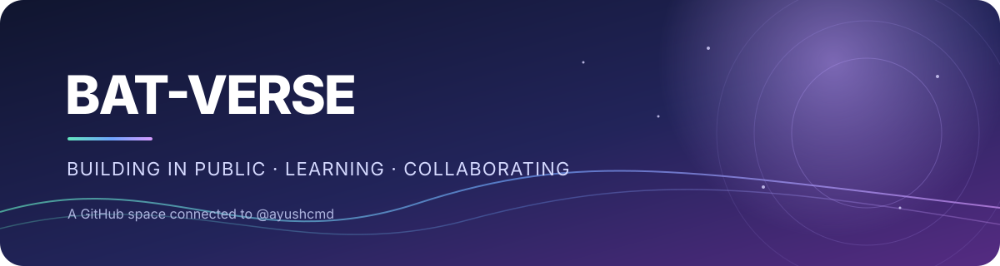

### An independent GitHub account connected to [@ayushcmd](https://github.com/ayushcmd)

**Building, learning, and contributing across GitHub.**

---

## About

Welcome to **bat-verse** — a space for development, experiments, and collaboration. This account is associated with **[@ayushcmd](https://github.com/ayushcmd)**. Explore the repositories to see what’s being built.

## GitHub activity

These cards show publicly available contribution and repository statistics for this account. They are generated by community services and may take a little time to update.

## Contributing

Have an idea or spotted something to improve? Contributions to this profile repository are welcome:

- Open an [issue](https://github.com/bat-verse/bat-verse/issues) to suggest an improvement or report a problem.
- Submit a [pull request](https://github.com/bat-verse/bat-verse/pulls) for README, artwork, or other repository improvements.
- Find more work and collaboration through [@ayushcmd](https://github.com/ayushcmd).

Please keep contributions constructive, clear, and respectful.

---

**Thanks for stopping by.** · [Explore repositories](https://github.com/bat-verse?tab=repositories) · [Connect with Ayush](https://github.com/ayushcmd)

